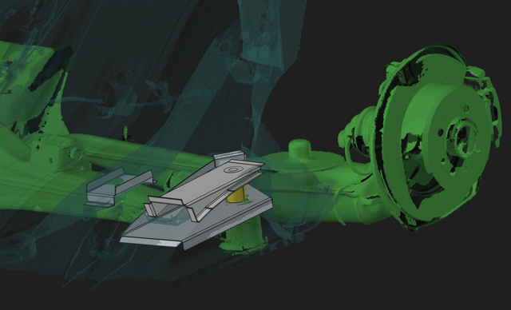
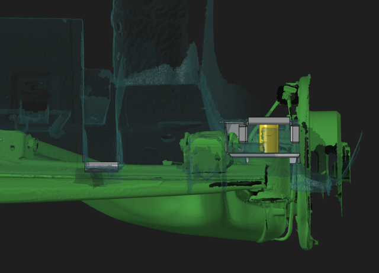
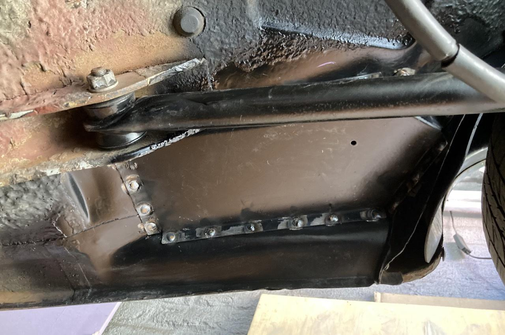
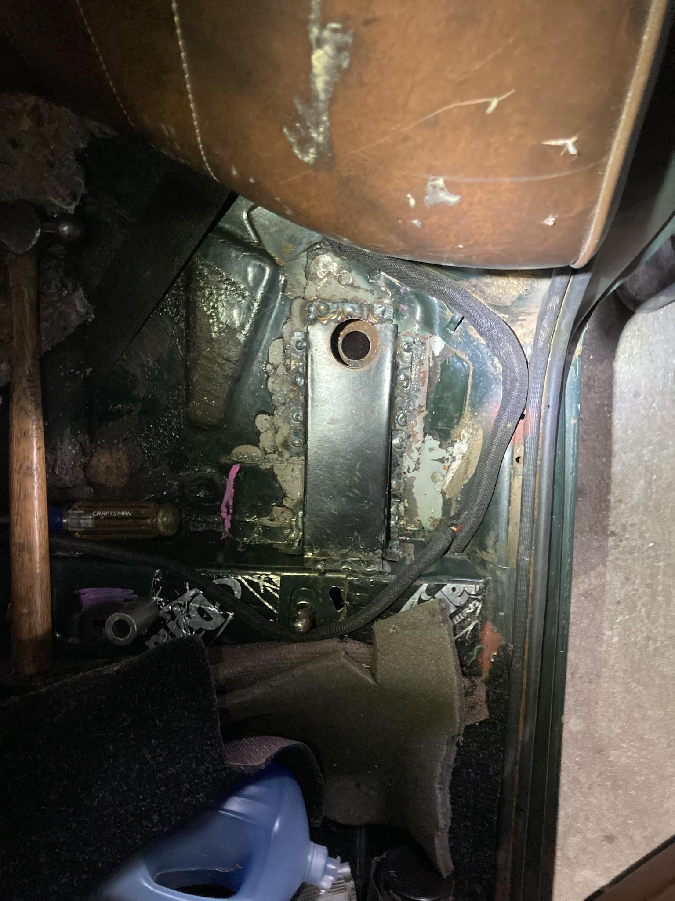

Sheetmetal parts for mounting an E30 subframe into a Fiat 124 Sedan unibody chassis. 
This might also work on Lada 2101 or later or Fiat 124 Coupe / Spider. 

BottomBox - Mounts under the car just in front of the back tire. Weld into place. 
            The small hole in sheetmetal is where to drill upwards into passenger compartment. 
TopBox - Mounts in the passenger compartment under the rear seat and above the BottomBox. 
RailNotch - The stock rear subframe needs to be notched to clear the E30 subframe, this fills in that notch. 

Also requires - Steel tube that fits the E30 subframe bushing that is held 
                captive between the bottom and top boxes. 

